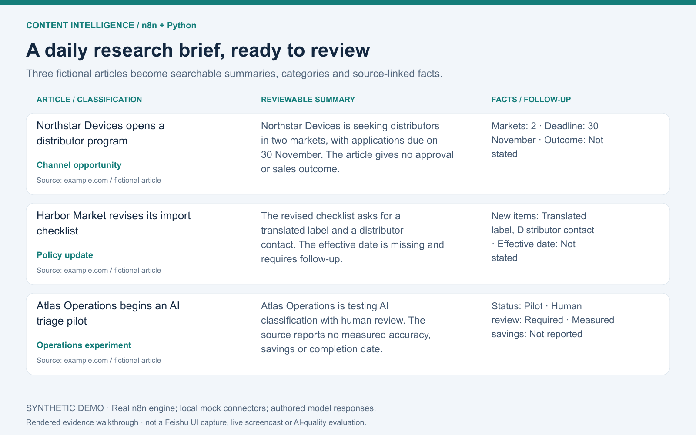

# 内容情报自动化：n8n 研究与监控工作流

**将订阅文章整理成可追溯来源的研究简报：增量同步、摘要、分类与关键事实，附 Python 实现。**

[English](README.md) · [n8n 使用说明](n8n/README.md) · [Python 使用说明](python/README.md) · [验证记录](docs/validation.md)



[观看 60 秒证据讲解视频](assets/demo/walkthrough.mp4) · [演示范围和复现方式](docs/demo.md)

上图来自**真实 n8n 引擎＋本地模拟接口**的运行输出。文章、公司和模型回复均为人工编写的合成样例；演示证明编排、解析和写回，不代表实际模型生成、飞书集成验收或 AI 准确率。视频由运行结果图组成，不是连续实操录屏。

## 为谁解决什么问题

研究和运营团队需要持续监控多组公众号，各组有不同的目标表、时间窗和摘要要求。如果每组都复制整套流程，后续修改、去重和付费接口管理都会变得困难。

本项目采用配置驱动的中央厨房：**业务入口读取配置 → 共用 Catch 抓取与写入 → 按需执行摘要和指标处理**。实际集成设计为 wechat2rss → n8n → 飞书多维表格 → 可选 AI／指标 API。

用户可以按主题检查结果、回看原始来源，并识别需要人工追问的信息。例如演示里的政策生效日期没有提供，就明确保留“未说明”；这是期望的审核方式示例，不是模型质量评估结果。

wechat2rss 是第三方上游服务。本项目负责业务编排、处理和系统集成；当前目标端是飞书，Airtable、Notion、Google Sheets 等仍需单独开发和验收。

## 我的职责与可迁移的交付能力

我的贡献包括业务需求、字段契约、复用架构、增量规则、付费调用复核策略、实现与验收迭代，开发过程中使用 AI 辅助。可迁移到类似客户需求的交付包括：配置驱动的监控流程、可检查的业务结果、异常处理、部署说明和交接材料。

这是个人工程作品，不包装为客户委托案例，也不虚构节省工时或成本。[贡献与第三方边界](docs/contributions.md)

## 看处理结果与异常行为

代表性路径 **Benchmark Entry → Catch → 结构化 Summary** 已在 n8n 2.19.5 的安全 JavaScript runner 中执行。测试副本将外部连接器替换成本地 HTTP 模拟接口；公开工作流保持未激活。

| 场景 | 本次观察 |
|---|---|
| 首次运行 | 新增 3 条文章，调用 3 次模型模拟接口，写回 3 条结构化结果 |
| 稳定复跑 | 0 次新增、0 次基础字段更新、0 次新增模型调用 |
| 配置仍有分页 | 在入口停止，避免从不唯一的配置中任取一条 |
| 目标端缺失文章 | Catch 可见性检查报错 |

七个原始导出也已通过 CLI 导入；该环境关闭社区节点加载，因此不能据此宣称原始连接器兼容。[机器可读证据](assets/evidence/n8n-engine-demo.json)

另有轻量 Catch 样例，展示**一条新增、一条更新、一条跳过**。它在 Node harness 中运行导出的 Code 节点，Python 对照检查相同 ID 与处理决策，和上述引擎演示是两类证据：

```bash
node scripts/demo_n8n.mjs
# 先按 Python 说明准备环境
python scripts/demo_python.py
python scripts/compare_demos.py
```

[输入样例](examples/catch-scenario.json) · [n8n 样例输出](assets/evidence/n8n-fixture-run.json) · [Python 样例输出](assets/evidence/python-fixture-run.json)

## 中央厨房设计


| 内容 | 能力与价值 |
|---|---|
| 行业新闻、AI 新闻、对标监控三个 Entry | 业务差异由配置管理，避免复制核心 |
| 一个 25 节点共用 Catch | 标准化、去重、增量写入、输出核验 |
| 两个 Summary、一个 Metrics | 付费处理与采集分离，成功结果缓存，不确定结果持续阻止重试 |
| Python CLI 与测试 | 同一业务分层的代码实现，方便评估代码集成能力 |

只保留七个当前工作流。Catch 拥有六个基础字段，Summary 和 Metrics 独立处理。Markdown 单独变化不会自动更新，这是明确保留的取舍。

调用进入 `uncertain` 后，即使重启也不会自动重新申请；需核实远端结果，通过[本地复核工具](docs/paid-call-recovery.md)明确批准重试并保留记录。这不构成绝不重复收费的保证。

Python 顺序运行，尚未实现 n8n benchmark 的全部结构化字段，因此不是完全等价的替代。[实现对照](docs/implementation-comparison.md)

## 验证与使用边界

原系统有历史部署背景；公开包的当前证据包括离线检查、真实 SQLite 状态回归，以及采用模拟接口的真实引擎演示。真实服务兼容性、实际 AI 输出质量和生产并发仍需独立验收。[完整验证记录](docs/validation.md)

凭证、真实环境标识、生产数据和原始日志不随仓库提供。使用者需在专用环境重新绑定服务、工作流和依赖，并完成验收后再安排调度。[公开范围](NOTICE.md)
