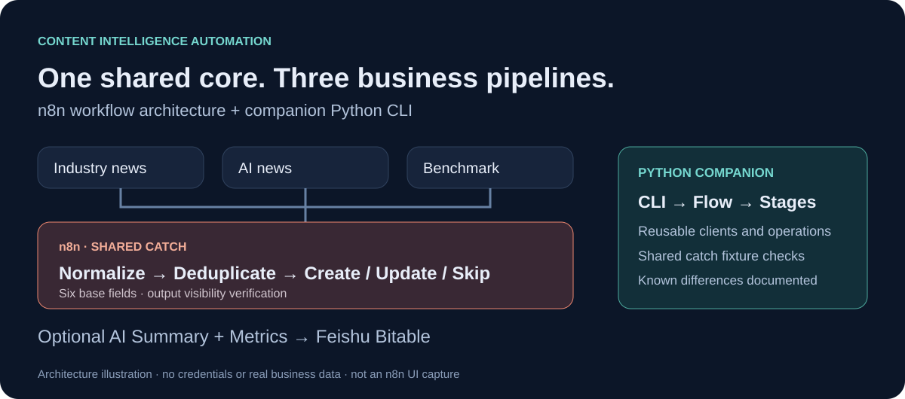
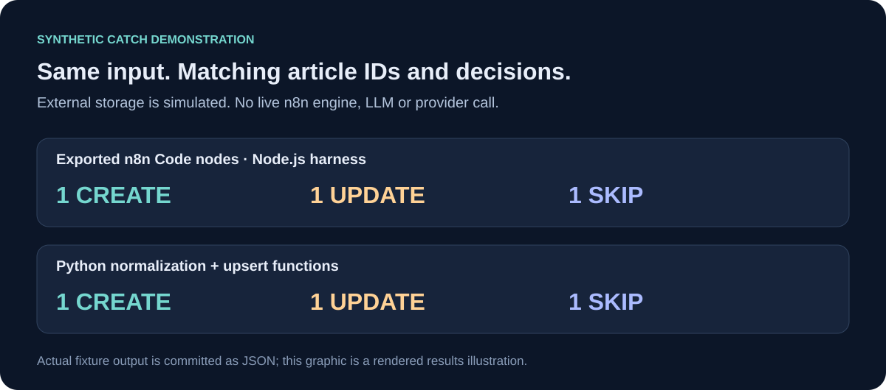

# 内容情报自动化：N8N 中央厨房与 Python 实现

[English](README.md) · [N8N 导入说明](n8n/README.md) · [Python 使用说明](python/README.md) · [验证记录](docs/validation.md)



## 解决什么问题

研究和运营团队需要持续监控多组公众号，各组又有不同的目标表、时间窗和摘要要求。如果每组都复制一整套流程，后续修改、去重和付费接口管理都会变得困难。

本项目采用配置驱动的中央厨房：**业务入口读取配置 → 共用 Catch 抓取与写入 → 按需执行摘要和指标处理**。主链路为 wechat2rss → N8N → 飞书多维表格 → 可选 AI／指标 API。

wechat2rss 是第三方上游服务；本项目展示围绕该服务的业务编排、文章处理与系统集成能力。当前目的端为飞书，尚未实现 Airtable、Notion 等适配。

## 当前作品包含什么

| 内容 | 展示的能力 |
|---|---|
| 行业新闻、AI 新闻、对标监控三个 Entry | 配置读取与业务路由 |
| 一个 25 节点共用 Catch | 标准化、去重、增量写入与可见性核验 |
| 两个 Summary、一个 Metric | AI／API 集成、SQLite 调用记录及缓存 |
| Python CLI 与测试 | 将同一业务模型分解为可维护代码 |

只保留当前七个有效工作流，排除旧实验、线上备份和内部交接资料。这是个人工程作品，不包装为客户委托项目。

## 看一遍实际处理逻辑



公开样例使用虚构文章，外部存储边界由测试模拟。N8N 侧执行的是导出文件中的真实 Code 节点代码，**不是完整 N8N 引擎执行**。

```bash
node scripts/demo_n8n.mjs
python scripts/demo_python.py
python scripts/compare_demos.py
```

两套实现对共享样例生成一致的文章 ID 与新增／更新／跳过决策。输入和输出均可查看：[样例](examples/catch-scenario.json)、[N8N 输出](assets/evidence/n8n-fixture-run.json)、[Python 输出](assets/evidence/python-fixture-run.json)。Python 命令的环境准备见其使用说明。

## 中央厨房设计



Entry 负责业务差异，Catch 只写六个基础字段；Summary 和 Metric 独立扫描待处理记录。修改目标表、提示词或处理开关，不必复制整个核心。

三个关键取舍是：业务配置放在入口；skip 不比较 markdown 的格式差异；付费调用记录与输出核验明确分层。Markdown 单独变化不会自动触发更新，这是有意保留的边界。

N8N 的 benchmark 入口在 Catch 后分出摘要和指标两支；Python 当前顺序执行，而且尚未复刻 benchmark 的全部结构化标签字段，因此不声称两套完全等价。[实现对照](docs/implementation-comparison.md)

## 验证与贡献

本版有新执行的离线检查、Code 节点样例与 Python 测试；完整 N8N 导入、真实接口集成和 Python 上线验收仍待补齐。历史部署记录与当前验证分开表述，不用测试通过推导全场景生产可用。[完整记录](docs/validation.md)

我的贡献包括需求与边界定义、复用架构、配置模型、增量写入规则、集成方案和基于验收反馈的迭代，开发过程中使用了 AI 辅助。[贡献说明](docs/contributions.md)

所有流程默认未激活。凭证、真实环境标识和运行数据均不随公开仓库提供；使用者自行配置依赖和测试环境。[公开范围](NOTICE.md)
