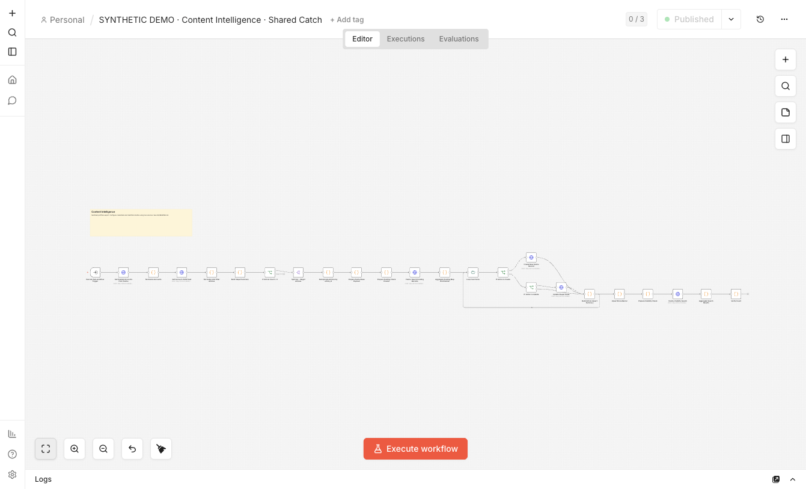

# Result-first demonstration

[Portfolio](../README.md) · [Recorded engine evidence](../assets/evidence/n8n-engine-demo.json) · [Validation](validation.md)

[Watch the silent 60-second walkthrough](../assets/demo/walkthrough.mp4)


## What you are seeing

A research desk receives three fictional articles: a distributor opportunity,
an import-checklist update and an AI operations pilot. The output preserves the
source link and stores a summary, category, tags and key facts. Missing dates
and unreported performance figures stay explicit in the authored responses.

The board is a visualization of the recorded simulated destination rows, not a
Feishu UI screenshot. The video is an evidence walkthrough made from rendered
frames, not a live screencast. All article text and model responses are authored
in [business-demo.json](../examples/business-demo.json); no model generated them.
This demonstrates parsing and data movement, not accuracy or real business ROI.

## Actual n8n interface captures



This unedited capture shows the private synthetic workflow in the real n8n UI
on 2026-10-22. It is an editor overview, not a historical production image or
proof of real Feishu connectivity. The workflow name retains the SYNTHETIC DEMO
label. The inspectable execution results are in the separate JSON evidence.

## Execution scope

The [runner](../scripts/demo_engine.py) first imports the seven original inactive
exports into a new private n8n instance. Community packages are disabled. Import
acceptance does not establish connector compatibility or full schema execution.

It then generates explicitly named private demo copies with these substitutions:

- Feishu, DeepSeek and feed/metrics HTTP nodes become loopback HTTP fixtures.
- Credentials are removed; child references point to demo IDs.
- Schedules become manual triggers; Entry workflows remain inactive.
- Feed hostname and SQLite path point to the private local environment.
- SQLite constructors use an explicit `nativeBinding` path. Default native-addon
  discovery failed in this secure runner; the demo does not weaken runner security.

Connections and business-processing Code are otherwise retained. Only the private
Catch and Benchmark Summary child versions are published, as n8n 2.19.5 CLI
sub-workflow execution requires published children. These have no schedule nodes.

The test executes Benchmark Entry → Catch → structured Summary. Metrics is
**disabled and not engine-accepted**. Other Entry/News Summary paths are not
covered by this engine run. Actual community nodes, feed authentication, model
requests and Feishu serialization remain separate integration gates.

| Scenario | Expected and observed |
|---|---|
| First execution | 3 creates; 3 model-fixture calls; 3 enriched records |
| Stable rerun | No creates, base updates or additional model calls |
| Incomplete/duplicate configuration | Fails at Build Config Snapshot before Catch |
| Missing expected destination row | Fails Catch output verification |

The script verifies execution results and output fields before writing the
bounded public JSON. Raw engine logs, generated workflow copies, SQLite state
and n8n account material stay in git-ignored `.work/`.

## Reproduce in an isolated local environment

Requires Node.js 22.16+ (the recorded run uses 22.22.0), Python 3.12+ and npm.
Installing dependencies downloads packages; executing the fixture uses only
loopback HTTP endpoints. Allow several GB for the optional n8n installation.
Use a clean shell with no production n8n settings.

```bash
npm install --prefix .work/n8n-runtime --no-audit --no-fund \
  n8n@2.19.5 better-sqlite3@12.4.1 @n8n/typeorm@0.3.20-16
python3 scripts/demo_engine.py --node-bin /path/to/node22/bin
```

Replace the Node binary directory with your local Node 22 installation. The
runner creates a fresh private instance per run. It does not start Docker or
connect to an existing n8n instance. The explicit TypeORM dependency avoids
duplicate DataSource classes observed in the initial local npm dependency tree.
Community connector packages are unnecessary for this fixture run.

Native package installation may require local build tooling. Runtime versions,
exact substitutions and source workflow hashes are included in the evidence.
This is an opt-in demonstration, not part of normal offline CI.

To regenerate the visual walkthrough from the recorded result:

```bash
# Requires librsvg's rsvg-convert and ffmpeg
python3 scripts/render_demo.py
```

## Live acceptance still required

Use dedicated test services to bind real connectors and credentials, inspect
actual model outputs, verify destination field types, and repeat the sequence.
Keep live acceptance distinct from this mock-boundary engine run. Three-entry
coverage, real concurrent persistence and paid-provider recovery are not implied.
