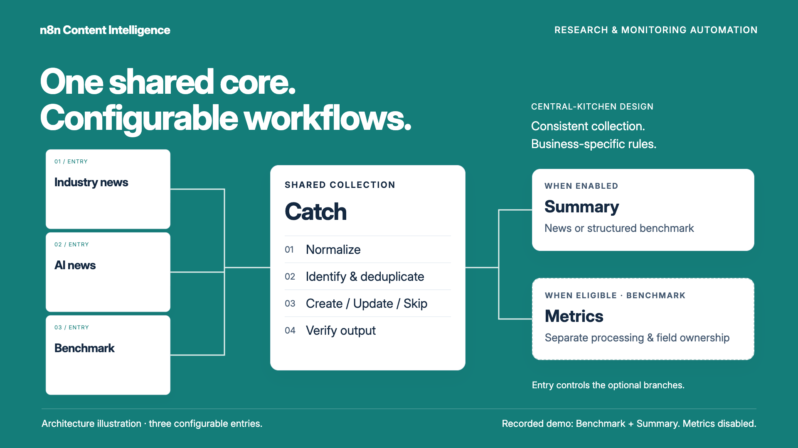

# Central-kitchen architecture film

[Watch the 60-second film](../assets/demo/central-kitchen.mp4) · [Poster](../assets/demo/central-kitchen-poster.png) · [Recorded demo scope](demo.md)

The film explains a design decision: **one shared processing core, configurable business workflows**. Three Entries keep business-specific settings, Catch owns collection and base-field writes, and Summary / Metrics own their enrichment responsibilities. Entry controls their eligibility. Metrics is not dependent on Summary succeeding.

## Story

| Time | Content |
|---|---|
| 0–8 seconds | Operator-reported continuous collection over 15 days: AI news 273, Benchmark 508, Industry news 102; combined count 883 |
| 8–14 seconds | Business-specific example configuration for Industry news, AI news and Benchmark |
| 14–24 seconds | Shared normalization, identification, incremental writes and output verification |
| 24–30 seconds | Optional Summary and eligible Metrics branches |
| 30–42 seconds | A source excerpt and the stored “Effective date: Not stated” field |
| 42–48 seconds | Release-check animation: save and summarize → repeat unchanged input → skip and reuse completed work |
| 48–54 seconds | Simulated missing-output check stops the test run for review |
| 54–60 seconds | Configure → validate → operate; Devon's contribution and a return to the reported 15-day / 883-record outcome |

## Provenance and limits

- This is a code-rendered explanatory film, not a live screencast or Feishu interface.
- The opening figures are [operator-reported aggregates](../assets/evidence/operator-reported-collection.json), supplied by Devon on 22 October 2026: continuous operation over the stated 15 days, with 883 records across three pipelines. They are not independently audited logs, and the sum is not a cross-pipeline unique-article count. The 15 days are an operating period, not a publication-date filter.
- Article facts and model responses come from [authored synthetic examples](../examples/business-demo.json). The configuration cards summarize [public example configuration](../examples/pipeline-config.json).
- The repeat-run animation and simulated failure case illustrate the [existing n8n engine record](../assets/evidence/n8n-engine-demo.json). The technical 3/0 table has been replaced by a visual explanation; the underlying test record is unchanged. Making this film did not rerun the engine or connect to live services.
- Configure → validate → operate presents the delivery approach. The film does not claim a documented historical deployment sequence or that these synthetic checks alone establish live reliability. The reported operating outcome remains a separate source of information.
- The recorded engine path is Benchmark Entry → Catch → structured Summary, using local mock connectors. Metrics was disabled. Showing the three-entry architecture does not establish live acceptance of all entries or providers.
- The source excerpt is shortened for readability. “Not stated” demonstrates preservation of an authored field, not measured model accuracy.
- Personal responsibility follows the [contribution record](contributions.md), including AI-assisted implementation. n8n, wechat2rss and hosted providers remain third-party services.
- Stable collection is explained through the reported continuous operation and the design's normalization, deduplication, incremental writes and output verification. No measured uptime percentage, success rate, collection completeness, time savings, cost reduction or AI accuracy is claimed.

## Media and editing

The master is 1920×1080, 60 fps, 60 seconds, with English on-screen text, original warm, upbeat instrumental music and 25 synchronized effects. There is no narration. The earlier [silent evidence walkthrough](../assets/demo/walkthrough.mp4) remains available separately.

The composition was authored with [huashu-motion](https://github.com/alchaincyf/huashu-motion) by Huashu, using HTML, GSAP and a locally rendered score. Its editable source package is supplied separately from this public repository; it contains the composition, local dependencies, score and applicable notices. No production state is included.

Typography uses Inter, © 2016 The Inter Project Authors, under SIL Open Font License 1.1. The current cue uses electric piano, guitar, bass and light drums from the huashu-motion instrument pack. Electric-piano samples are by [Greg Sullivan](http://www.sullivang.net/), licensed under [CC BY 3.0](https://creativecommons.org/licenses/by/3.0/), and trimmed, resampled and re-encoded in the pack. Guitar and bass include FreePats materials; drum samples retain their respective pack credits. The full sample-pack notice accompanies the editable source. The film's score and timing are specific to this project.

Rendering and layout checks are media checks. They do not expand the integration evidence described above. Final musical taste and reading pace remain subject to human review.
